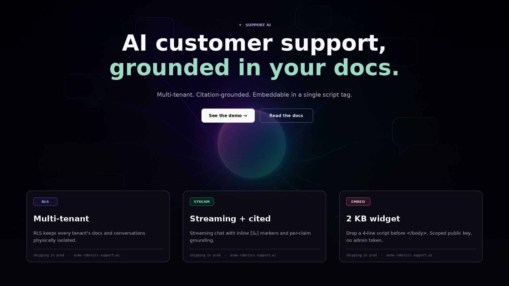
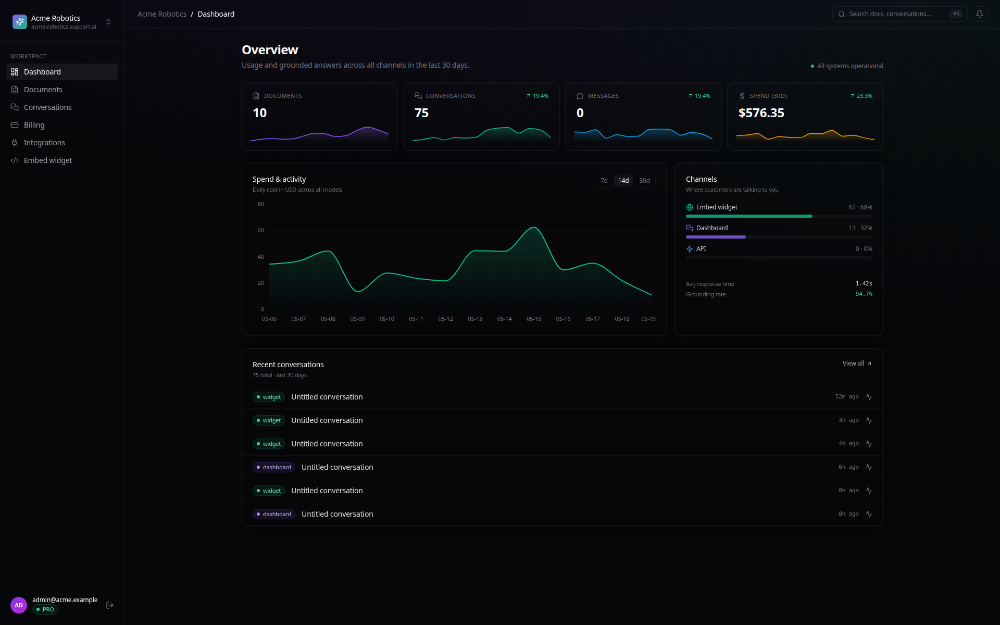
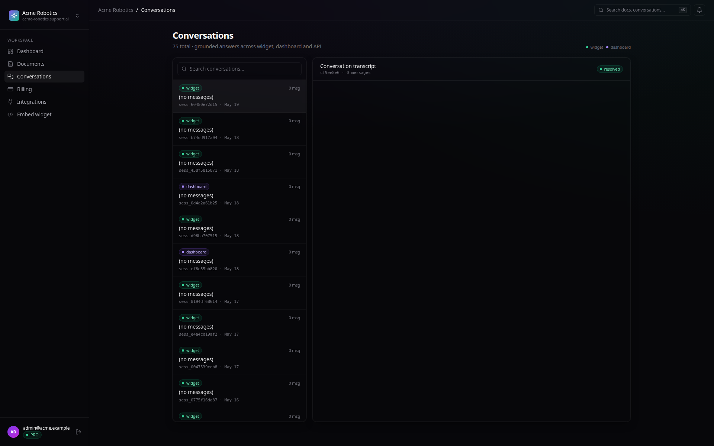
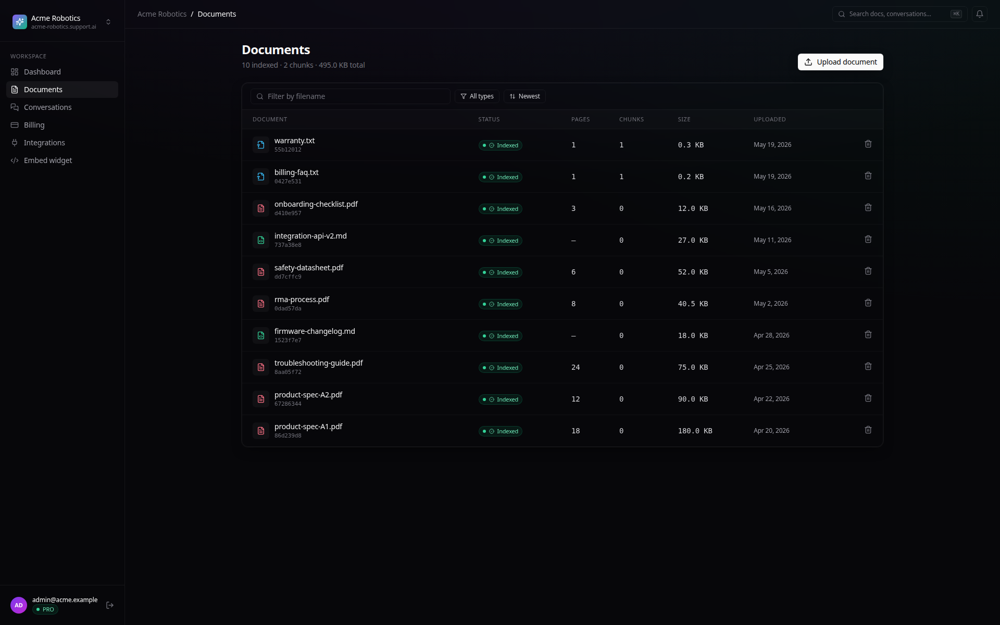
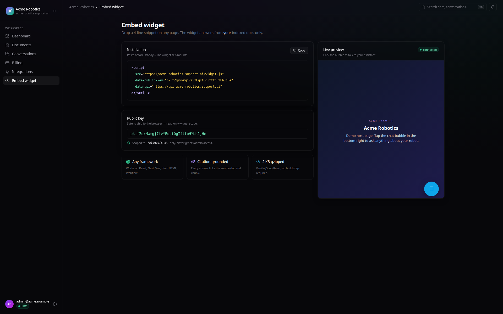
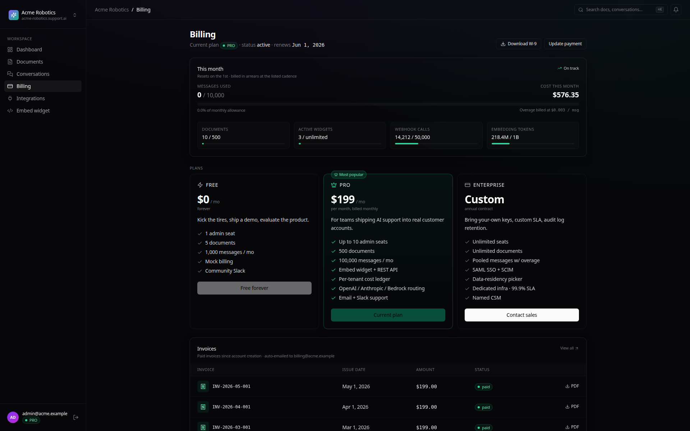
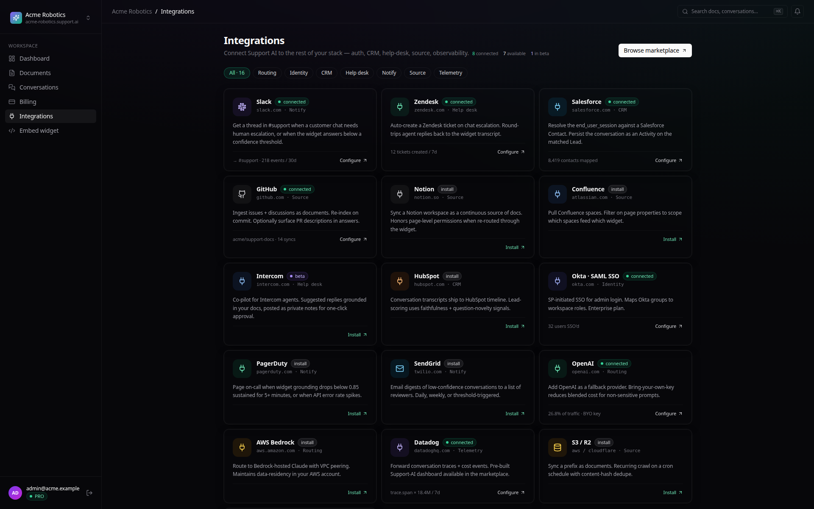

<div align="center">

# GroundTruth

**Multi-tenant AI support platform engineered with PostgreSQL Row-Level Security, pre-request financial cost gating, real-time citation-grounded streaming, and synchronized billing.**



[](https://www.python.org/)
[](https://fastapi.tiangolo.com/)
[](https://nextjs.org/)
[](https://www.postgresql.org/docs/current/ddl-rowsecurity.html)
[](https://www.anthropic.com/)
[](https://stripe.com/)
[](LICENSE)

</div>

---

## Table of Contents

- [Motivation](#motivation)
- [The Problem](#the-problem)
  - [1. Cross-Tenant Data Leakage in Vector RAG](#1-cross-tenant-data-leakage-in-vector-rag)
  - [2. Runaway LLM Costs and Budgeting Blindspots](#2-runaway-llm-costs-and-budgeting-blindspots)
  - [3. Billing-to-Database State Drift](#3-billing-to-database-state-drift)
- [The Solution](#the-solution)
  - [Architectural Highlights](#architectural-highlights)
  - [Defense-in-Depth Cost Governance](#defense-in-depth-cost-governance)
  - [Resilient Stripe Lifecycle Sync](#resilient-stripe-lifecycle-sync)
  - [Dual-Mode Operations](#dual-mode-operations)
- [Detailed Technical Explanation](#detailed-technical-explanation)
  - [System Architecture Diagram](#system-architecture-diagram)
  - [End-to-End Request Lifecycle](#end-to-end-request-lifecycle)
  - [Document Ingestion Pipeline](#document-ingestion-pipeline)
  - [Engineering Deep Dives](#engineering-deep-dives)
    - [PostgreSQL Row-Level Security (RLS) Policy Design](#postgresql-row-level-security-rls-policy-design)
    - [Pre-Request Monthly Cost Budget Enforcement](#pre-request-monthly-cost-budget-enforcement)
    - [Stripe Webhook Plan & Status Reconciliation](#stripe-webhook-plan--status-reconciliation)
- [Tech Stack](#tech-stack)
- [Screenshots](#screenshots)
- [Setup & Quickstart](#setup--quickstart)
  - [Prerequisites](#prerequisites)
  - [Installation](#installation)
  - [Pre-Seeded Demo Tenants](#pre-seeded-demo-tenants)
  - [Embed Widget Usage](#embed-widget-usage)
- [Verification & Automated Tests](#verification--automated-tests)
- [Provenance](#provenance)
- [License](#license)

---

## Motivation

Deploying generative AI into customer support presents a stark engineering paradox: organizations need autonomous, 24/7 resolution of customer inquiries, but off-the-shelf LLMs are fundamentally unbounded systems. When unconstrained, they hallucinate unsupported claims, leak proprietary cross-tenant data across shared databases, generate surprise infrastructure bills, and drift out of sync with commercial subscription states.

Most multi-tenant AI prototypes rely on fragile application-level filters (`WHERE tenant_id = ...`), post-hoc cost monitoring dashboards, and naive billing webhook handlers that leave churned accounts active. 

**GroundTruth** was built to eliminate these production failure modes at the architecture layer. It provides an enterprise-ready, multi-tenant RAG platform where tenant data isolation is enforced directly by PostgreSQL Row-Level Security, AI usage is gated by pre-request dollar budgets before model calls occur, answers are provably grounded in indexed documentation via real-time citations, and subscription state changes synchronize atomically between Stripe and the tenant database.

---

## The Problem

### 1. Cross-Tenant Data Leakage in Vector RAG
In a multi-tenant SaaS application, multiple companies share the same database and vector search index. Standard developer practice relies on ORM-level filters or application query parameters (`WHERE tenant_id = current_tenant`). 
However, in production architectures with asynchronous job workers, complex vector similarity joins, document retrieval pipelines, and analytical queries, a single missed filter or developer oversight leaks Tenant A's private internal documentation to Tenant B's end users. When dealing with proprietary customer data, application-layer filtering is an unacceptable single point of failure.

### 2. Runaway LLM Costs and Budgeting Blindspots
SaaS products commonly restrict tenant usage by counting messages (e.g., "1,000 messages/month"). In an LLM-powered application, message counts are a dangerous proxy for actual financial exposure:
- A malicious or automated user can submit a 100,000-token prompt or trigger maximum-length completions on every turn.
- A tenant staying well within their 200-message monthly tier can easily rack up tens or hundreds of dollars in provider API fees.
- Recording token costs into an accounting ledger *after* an inference call provides observability, but it does not prevent financial hemorrhaging. The application must gate requests **before** dispatching calls to expensive frontier models.

### 3. Billing-to-Database State Drift
Subscription billing via webhooks is notorious for state desynchronization:
- **Status Blindness**: Naive webhook consumers treat any event other than explicit deletion as `active`. When Stripe emits `customer.subscription.updated` with status `past_due`, `unpaid`, or `incomplete`, naive handlers continue granting full application access.
- **Plan Desynchronization**: When a customer upgrades or downgrades tiers, Stripe fires `customer.subscription.updated`. If the application only updates the internal `Subscription` table without updating the core `Tenant.plan` record, frontend widgets and quota guards continue reading stale tier limits indefinitely.
- **Lost Metadata**: Checkout sessions that fail to pass tenant metadata down to the underlying subscription object break webhook reconciliation when subsequent billing cycle events fire.

---

## The Solution

GroundTruth addresses each failure mode with defense-in-depth systems engineering:

### Architectural Highlights
- **Postgres 16 Row-Level Security (RLS)**: Isolation is guaranteed by the database engine. Every database transaction sets `app.tenant_id` via `set_config()`. Any query attempting to access or search chunks belonging to another tenant returns zero rows—even if application code omits the WHERE clause.
- **pgvector Cosine Retrieval**: Vector embeddings (1,536 dimensions) are stored alongside text chunks and searched via cosine distance (`<=>`), operating entirely inside the active RLS session context.
- **Real-Time Streaming with Inline Citations**: Server-Sent Events (`sse-starlette`) stream responses from Anthropic's Claude (`claude-sonnet-4-6`) with inline citation tags (`[S1]`, `[S2]`) directly mapped to source document chunks.
- **Lightweight Embed Widget**: A standalone, 2 KB vanilla JavaScript widget with zero framework dependencies. It embeds on any host page via a scoped public key and persists visitor chat sessions in client `localStorage`.

### Defense-in-Depth Cost Governance
GroundTruth enforces a three-tier cost control architecture:
1. **Pre-Request Message Quota**: Rejects requests when monthly conversation counts exceed `PLAN_LIMITS[plan].messages_per_month`.
2. **Pre-Request Cost Budget**: Sums all `UsageEvent.cost_usd` for the tenant's current billing cycle. If accumulated spend meets or exceeds `PLAN_LIMITS[plan].cost_budget_usd` ($5 Free, $50 Pro, $500 Enterprise), the request is rejected with HTTP 402/PlanLimitExceeded **before any vector search or Claude API invocation occurs**.
3. **Post-Request Token Ledger**: Extracts exact prompt and completion token counts from the model response, calculates precise dollar costs, and writes an immutable record to `usage_events`.

### Resilient Stripe Lifecycle Sync
- Webhooks inspect Stripe's native `status` field (`active`, `past_due`, `unpaid`, `trialing`, `canceled`), mapping them directly to strict internal states.
- Multi-channel plan resolution extracts the updated tier from subscription metadata, falling back dynamically to Stripe Price ID mappings.
- Atomic transaction execution (`update_tenant_subscription`) updates `Subscription.plan`, `Subscription.status`, and `Tenant.plan` simultaneously, preventing tier drift.

### Dual-Mode Operations
Built for rapid local development and seamless production deployment:
- **Authentication**: `AUTH_PROVIDER=dev` (local HS256 JWT with bcrypt) or `AUTH_PROVIDER=clerk` (cryptographic verification of Clerk session tokens).
- **Billing**: `BILLING_PROVIDER=mock` (in-memory mock provider with instant upgrades) or `BILLING_PROVIDER=stripe` (live Stripe Checkout and signed webhook handling).

---

## Detailed Technical Explanation

### System Architecture Diagram

```
┌────────────────────────────────┐         ┌─────────────────────────────┐
│    End-User / Host Website     │         │    Admin Console (Next.js)  │
│  (vanilla widget.js, 2 KB)     │         │   Overview, Docs, Billing   │
└──────────────┬─────────────────┘         └─────────────┬───────────────┘
               │                                         │
               │ HTTPS / SSE                             │ JWT (Dev / Clerk)
               ▼                                         ▼
┌────────────────────────────────────────────────────────────────────────┐
│                        FastAPI Application Gateway                     │
│                                                                        │
│  ┌───────────────────────┐  ┌───────────────────────────────────────┐  │
│  │ Auth & Context Setup  │  │ Cost & Rate Limit Gating              │  │
│  │ - Public Key / JWT    │  │ - Pre-flight message count check      │  │
│  │ - Resolve Tenant ID   │  │ - Pre-flight MTD cost budget check    │  │
│  └───────────┬───────────┘  └───────────────────┬───────────────────┘  │
│              │                                  │                      │
│              ▼                                  ▼                      │
│  ┌──────────────────────────────────────────────────────────────────┐  │
│  │  Transaction Scoping: set_config('app.tenant_id', id, local=true)│  │
│  └──────────────────────────────────┬───────────────────────────────┘  │
└─────────────────────────────────────┼──────────────────────────────────┘
                                      │
              ┌───────────────────────┴───────────────────────┐
              ▼                                               ▼
┌───────────────────────────────┐           ┌───────────────────────────────────┐
│     PostgreSQL 16 + RLS       │           │        External AI Providers      │
│                               │           │                                   │
│  • documents                  │           │  1. OpenAI text-embedding-3-small │
│  • document_chunks (pgvector) │◄─────────►│     (1536-dim vector embeddings)  │
│  • messages & conversations   │           │                                   │
│  • usage_events (cost ledger) │           │  2. Anthropic Claude              │
│  • tenants & subscriptions    │           │     (model: claude-sonnet-4-6)    │
└───────────────────────────────┘           └───────────────────────────────────┘
```

### End-to-End Request Lifecycle

1. **Authentication & Ingestion**: The request arrives at `/widget/chat` (public key) or `/chat/stream` (admin JWT). The tenant identity is resolved.
2. **Database Context Binding**: The async session calls `set_config('app.tenant_id', tenant_id, true)`, scoping the GUC to the current transaction. RLS policies activate for all subsequent queries within that transaction.
3. **Pre-Flight Quota & Budget Enforcement**:
   - `_check_message_quota`: Counts tenant messages created in the current month.
   - `_check_cost_budget`: Computes `SELECT SUM(cost_usd) FROM usage_events WHERE tenant_id = :id AND created_at >= date_trunc('month', now())`. If spend exceeds the plan budget ($5 / $50 / $500), execution halts immediately.
4. **Vector Similarity Retrieval**:
   - The query text is embedded via OpenAI `text-embedding-3-small` (1,536 dimensions).
   - Postgres executes a cosine similarity search (`chunks.embedding <=> query_vector`).
   - RLS strictly ensures chunks belonging to other tenants are invisible to the query planner.
5. **Context Assembly & Generation**:
   - The top-$k$ retrieved chunks are formatted with source identifiers (`[S1]`, `[S2]`).
   - The system prompt instructs Claude (`claude-sonnet-4-6`) to answer strictly using the provided context and append source citations.
6. **Streaming Delivery**: Tokens stream over Server-Sent Events (SSE). The frontend renders the response in real time, displaying inline badges linked to source files.
7. **Token Accounting Ledger Commit**:
   - Upon stream completion, exact input and output token counts are retrieved from Anthropic metadata.
   - A new row is written to `usage_events` with the calculated dollar cost, updating the tenant's ledger.

---

### Document Ingestion Pipeline

```
  [Uploaded File] (PDF / TXT / Markdown)
         │
         ▼
  [Text Extraction] (pypdf text extractor / UTF-8 decode)
         │
         ▼
  [Token-Aware Sliding Chunker] (tiktoken cl100k_base)
         │  • Chunk size: 512 tokens
         │  • Overlap: 64 tokens
         ▼
  [OpenAI Embedding Generator] (text-embedding-3-small)
         │  • 1536-dimensional float vector
         ▼
  [Transactional Store Write] (Postgres + pgvector)
         • Insert document row (tenant-scoped)
         • Batch insert document_chunks with RLS verification
```

---

### Engineering Deep Dives

#### PostgreSQL Row-Level Security (RLS) Policy Design

Rather than trusting application developers to remember `WHERE tenant_id = :current_tenant` across dozens of endpoints, GroundTruth delegates isolation to the database kernel. The initial Alembic migration ([`20260518_0001_initial.py`](backend/alembic/versions/20260518_0001_initial.py)) applies a single `tenant_isolation` policy to every tenant-scoped table:

```sql
-- Applied to: users, documents, chunks, conversations,
--             messages, usage_events, subscriptions
ALTER TABLE <tbl> ENABLE ROW LEVEL SECURITY;

CREATE POLICY tenant_isolation ON <tbl>
USING (
    tenant_id::text = current_setting('app.tenant_id', true)
    OR current_setting('app.tenant_id', true) = '__bootstrap__'
)
WITH CHECK (
    tenant_id::text = current_setting('app.tenant_id', true)
    OR current_setting('app.tenant_id', true) = '__bootstrap__'
);
```

The `__bootstrap__` sentinel is the only explicit bypass, used exclusively during signup (before a tenant context exists). Every other path calls `set_tenant_guc()`, which scopes the GUC to the current transaction via `set_config(..., is_local=true)`:

```python
# db.py — set_tenant_guc()
await session.execute(
    text("SELECT set_config('app.tenant_id', :t, true)"),
    {"t": str(tenant_id)},
)
```

If a session runs without calling `set_tenant_guc()`, the GUC is empty and the `tenant_id::text = ''` condition matches zero rows — **fail-closed by design**.


#### Pre-Request Monthly Cost Budget Enforcement

Post-request cost ledgers show how money was spent, but they cannot prevent abuse. GroundTruth executes a pre-flight ledger aggregation in [`stream.py`](backend/src/saas/chat/stream.py):

```python
async def _check_cost_budget(session: AsyncSession, tenant_id: UUID) -> None:
    tenant = await session.get(Tenant, tenant_id)
    if not tenant:
        raise HTTPException(status_code=404, detail="Tenant not found")
    
    plan_limit = PLAN_LIMITS[tenant.plan]
    if plan_limit.cost_budget_usd <= 0:
        return

    # Sum usage events within the current calendar month
    result = await session.execute(
        select(func.coalesce(func.sum(UsageEvent.cost_usd), 0.0)).where(
            UsageEvent.tenant_id == tenant_id,
            UsageEvent.created_at >= func.date_trunc("month", func.now()),
        )
    )
    mtd_cost = float(result.scalar_one())

    if mtd_cost >= plan_limit.cost_budget_usd:
        raise PlanLimitExceeded(
            f"Monthly cost budget exceeded for plan '{tenant.plan.value}': "
            f"${mtd_cost:.2f} spent of ${plan_limit.cost_budget_usd:.2f} limit. Upgrade required."
        )
```

If a tenant exceeds their financial budget, the exception triggers before vector search or Claude model streaming initializes, guaranteeing zero LLM compute is consumed.

#### Stripe Webhook Plan & Status Reconciliation

In [`stripe_provider.py`](backend/src/saas/billing/stripe_provider.py), webhook handling prevents billing drift through atomic updates and defensive status mapping:

1. **Explicit Checkout Session Metadata**:
   When creating sessions, metadata is propagated directly to the subscription object:
   ```python
   subscription_data={"metadata": {"tenant_id": str(tenant_id), "plan": plan.value}}
   ```
2. **Defensive Status Mapping**:
   Instead of assuming all non-deletion events are active, Stripe's exact status string is mapped:
   ```python
   raw_status = data.get("status", "active")
   status = {
       "active": SubscriptionStatus.active,
       "past_due": SubscriptionStatus.past_due,
       "unpaid": SubscriptionStatus.unpaid,
       "canceled": SubscriptionStatus.canceled,
       "trialing": SubscriptionStatus.trialing,
   }.get(raw_status, SubscriptionStatus.incomplete)
   ```
3. **Atomic Tenant & Subscription Sync**:
   `update_tenant_subscription` commits updates to both `Subscription` and `Tenant` records in a single database transaction, ensuring the API gateway immediately reflects new plan tiers.

---

## Tech Stack

| Layer | Technology | Engineering Rationale |
|---|---|---|
| **Backend Framework** | Python 3.11, FastAPI | High-performance asynchronous API framework with native OpenAPI schema generation and async ecosystem. |
| **Database & Vector Engine** | PostgreSQL 16 + pgvector | Industrial-grade transactional database combining ACID compliance, Row-Level Security, and in-database 1,536-dim vector indexing. |
| **Language Model** | Anthropic Claude (`claude-sonnet-4-6`) | Configured foundation model providing superior reasoning, precise document grounding, and low-latency token streaming. |
| **Embeddings** | OpenAI `text-embedding-3-small` | Cost-effective, high-accuracy semantic embeddings producing 1,536-dimensional dense vectors. |
| **Data Access & Migration** | SQLAlchemy 2.0 (asyncpg) + Alembic | Modern async ORM with typed expressions and production-grade database schema migration tracking. |
| **Streaming** | `sse-starlette` | Standard Server-Sent Events protocol enabling real-time token streaming to frontend and widget clients. |
| **Auth System** | Dual-Mode: HS256 JWT (Dev) / Clerk (Prod) | Fast, zero-dependency local development via PyJWT & bcrypt, with instant production cutover to Clerk. |
| **Billing Engine** | Dual-Mode: In-Memory Mock / Stripe v11.3 | Mock billing provider for isolated local testing, paired with Stripe Checkout and webhook reconciliation for production. |
| **Frontend UI** | Next.js 14, TypeScript, Tailwind CSS | React App Router admin dashboard with server components, responsive layout, and Recharts telemetry graphs. |
| **Embed Widget** | Vanilla JavaScript (2 KB gzipped) | Zero-dependency, framework-agnostic client embed script with resilient DOM mounting and localStorage persistence. |
| **Operations** | Docker Compose, structlog, Tenacity | Containerized reproducible deployment, structured JSON logging, and resilient API call retries. |

---

## Screenshots

<table>
<tr>
<td width="50%"></td>
<td width="50%"></td>
</tr>
<tr>
<td></td>
<td></td>
</tr>
<tr>
<td></td>
<td></td>
</tr>
</table>

---

## Setup & Quickstart

### Prerequisites
- [Docker](https://docs.docker.com/get-docker/) & [Docker Compose](https://docs.docker.com/compose/)
- API keys for Anthropic and OpenAI (optional in mock/dev test mode)

### Installation

1. **Clone the repository**:
   ```bash
   git clone https://github.com/Samyak-Gajghate/groundtruth
   cd groundtruth-main
   ```

2. **Configure environment variables**:
   ```bash
   cp .env.example .env
   ```
   *Edit `.env` to supply `ANTHROPIC_API_KEY` and `OPENAI_API_KEY`. Defaults to `AUTH_PROVIDER=dev` and `BILLING_PROVIDER=mock`.*

3. **Spin up containers**:
   ```bash
   docker compose up -d --build
   ```

4. **Run migrations and seed demo data**:
   ```bash
   docker compose exec backend alembic upgrade head
   docker compose exec backend python -m scripts.seed_demo
   ```

5. **Access the applications**:
   - **Admin Dashboard**: [http://localhost:3002](http://localhost:3002)
   - **FastAPI OpenAPI Docs**: [http://localhost:8000/docs](http://localhost:8000/docs)
   - **Embeddable Widget Script**: [http://localhost:8000/static/widget.js](http://localhost:8000/static/widget.js)

---

### Pre-Seeded Demo Tenants

The seeding script creates two distinct tenants with isolated document corpora:

| Tenant | Admin Email | Password | Indexed Knowledge Base |
|---|---|---|---|
| **Acme Robotics** | `admin@acme.example` | `acmedemo1!` | Billing FAQ + warranty terms (2 documents) |
| **Globex Logistics** | `admin@globex.example` | `globexdemo1!` | Delivery windows + returns policy (2 documents) |

Log into both accounts in separate tabs to observe complete isolation: vector search queries from Acme will never retrieve Globex logistics documentation.

---

### Embed Widget Usage

To mount the GroundTruth support assistant onto any host website, include the lightweight script snippet:

```html
<script src="http://localhost:8000/static/widget.js"
        data-public-key="pk_live_acmerobotics..."
        data-api="http://localhost:8000"></script>
```

The widget automatically mounts a floating launcher, connects to the streaming endpoint, and renders verified document citations.

---

## Verification & Automated Tests

GroundTruth includes a comprehensive automated test suite covering unit logic, pricing calculations, chunking boundaries, Stripe webhook handlers, and pre-request budget enforcement.

To run the test suite inside Docker:
```bash
docker compose exec backend pytest -v
```

Or using the local backend environment:
```bash
cd backend
.venv/bin/pytest -c pyproject.toml -v
```

### Test Suite Coverage
- `test_cost_budget.py`: Asserts chat proceeds when under budget, and verifies **`claude_stream` is called 0 times** when a tenant exceeds their monthly dollar budget.
- `test_stripe_webhook.py`: Verifies `checkout.session.completed`, plan upgrades, price-item downgrades, `past_due` status preservation, and subscription cancellation.
- `test_chunking.py`: Validates token-aware text chunking bounds and sliding window overlaps.
- `test_pricing.py`: Tests monotonic token pricing calculations for chat completions and embedding generation.
- `test_dev_auth.py`: Cryptographic verification of HS256 JWT tokens, expiry enforcement, and tampering rejection.
- `test_tenant_isolation.py`: Database-level integration test confirming queries under Tenant A return zero rows for Tenant B data under PostgreSQL RLS.

---

## Provenance

GroundTruth builds upon an open-source multi-tenant SaaS foundation, adapted and substantially extended with production-grade PostgreSQL Row-Level Security, synchronized Stripe billing reconciliation, and pre-request financial cost controls.

---

## License

Distributed under the [MIT License](LICENSE).
